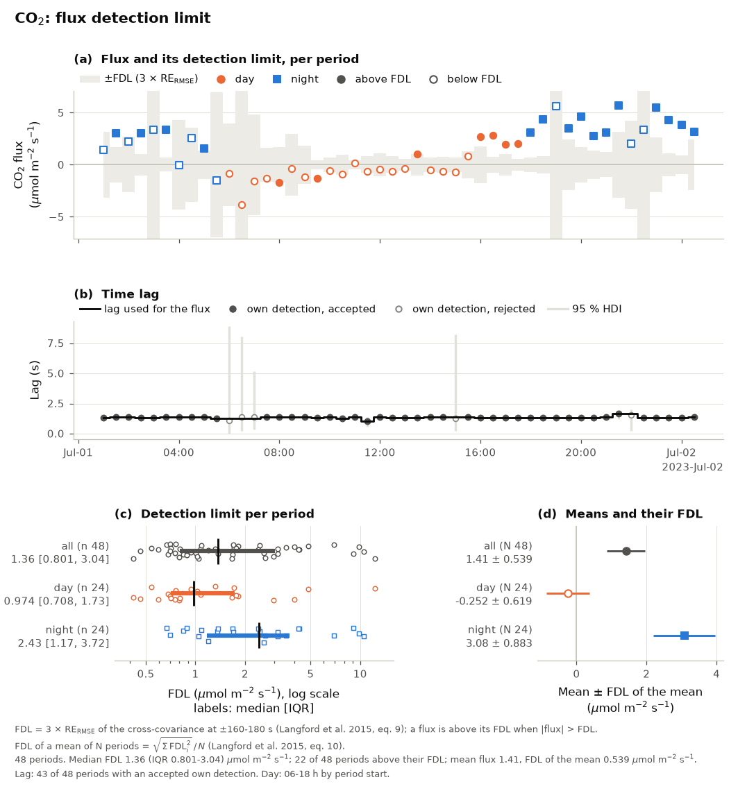
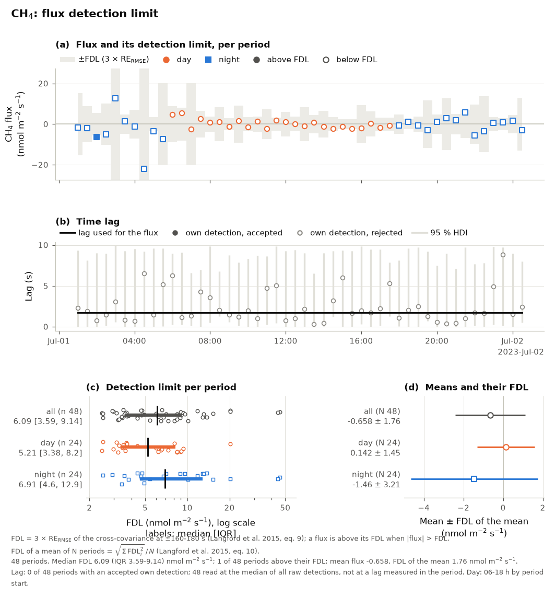

# Flux detection limit

`dyco fdl` determines, for each averaging period and each gas, whether the flux can be distinguished
from random noise. It computes two quantities per period:

- the **flux detection limit** (FDL): the smallest flux that stands out from the random error of
  that period, following Langford et al. (2015);
- the **flux** itself, read at the time lag that PWB and PWBOPT chose for that gas and period.

It writes a results table with one row per period, a log that ends with the numbers to report, and
one figure per gas. It writes no data files: removing the lag from the raw data is the job of
[`dyco detect-remove`](cli/detect-remove.md); see
[Relation to dyco detect-remove](#relation-to-dyco-detect-remove).

The method is most useful for gases with a low signal-to-noise ratio, such as N₂O and CH₄ over many
ecosystems, where a half-hourly flux is often small compared with its random error.

To see it on real data first, go to [Worked example: CH-OE2, one day](#worked-example-ch-oe2-one-day).
It runs on files that ship with the repository and shows every output.

## How it is computed

Each averaging period is processed on its own: the wind is double-rotated once, PWB detects the lag
of every gas, and the cross-covariance between the rotated vertical wind and each gas is computed at
every lag out to ±180 s. Then PWBOPT chooses the final lag of each gas across the whole sequence of
periods, as `dyco detect-remove` does, and the flux is read off that period's cross-covariance at
that lag.

### The cross-covariance

For a lag of `t` records, with `w` the rotated vertical wind and `c` the gas, both over the whole
averaging period of `n` records (Langford et al. 2015, eq. 4):

```text
cov(t) = 1/(n - |t|) * sum over i of (w[i] - mean(w)) * (c[i + t] - mean(c))
```

The means are those of the whole period (block averaging), and the sum runs over the `n - |t|` pairs
that overlap. Missing records are skipped, in the means and in each sum. A positive `t` means the gas
arrives after the wind, which is what a tube delay looks like, and is the same sign convention as
the PWB lag. The covariance is computed for all lags at once by FFT.

The covariance is turned into a flux with the molar density of dry air:

```text
flux(t) = cov(t) * p_d / (R * T_a)

e   = x_H2O * p              partial pressure of water vapour, Pa
p_d = mean(p - e)            dry-air partial pressure, Pa
T_a = mean(T_s / (1 + 0.32 * x_H2O))   air temperature from sonic temperature, K
R   = 8.314 J mol-1 K-1
```

The flux is in the gas's unit times m⁻² s⁻¹: a gas given as a dry mole fraction in nmol mol⁻¹ gives
a flux in nmol m⁻² s⁻¹. Sonic temperature, H₂O and pressure enter the conversion only through their
period means, so they need to be correct on average, not record by record.

### The random error and the detection limit

At lags far beyond any tube delay, the wind and the gas cannot still be physically related, so the
covariance found there is random error. dyco takes two windows at the ends of the lag range, by
default -180 to -160 s and +160 to +180 s, and combines the scatter and the offset from zero of the
flux in each (Langford et al. 2015, eq. 9):

```text
RE_RMSE = sqrt( 0.5 * ( sd_left**2 + mean_left**2 + sd_right**2 + mean_right**2 ) )

FDL = 3 * RE_RMSE
```

`sd_left` and `mean_left` are the standard deviation and the mean of `flux(t)` over every lag in the
left window, and likewise on the right. The factor 3 is the α of Langford et al. for the 99th
percentile and is fixed in dyco. The windows are those of Striednig et al. (2020); Langford et al.
use ±150 to 180 s in their example. `--fdl-lag-range` (default 180 s) sets the outer edge and
`--noise-range` (default 20 s) the width of each window.

The detection limit does not depend on the time lag. The flux does.

**Short periods get no detection limit.** The covariance at a lag `t` pairs only the period minus
`t` of data (eq. 4 divides by `n - t`), while the flux at the tube delay uses nearly the whole
period. The far-lag covariances therefore scatter more than the flux does, and the limit comes out
too high by about `sqrt(L / (L - t))` for a period of length `L`: 5 % for 30 minutes with the
default ±180 s, but 50 % for a 5-minute period. A period shorter than 5 times `--fdl-lag-range`
(15 minutes at the default) gets its flux but no detection limit, and `{gas}_error` says why. Such
periods are usually the incomplete last part of a file.

### Choice of lag for the flux

The usual way to find a lag is to take the position of the largest absolute covariance inside a
search window. For a strong flux that works. For a flux near zero it does not: the largest of many
noisy values tends to lie further from zero than a typical one, so the flux is pushed away from
zero, up or down. Over many periods, a gas with a true flux near zero then shows two groups of fluxes
on either side of zero and few close to it. Langford et al. (2015) call this mirroring (their Figs.
6, 8 and 9) and recommend reading low signal-to-noise fluxes at a prescribed lag instead.

dyco reads every flux at the lag PWBOPT chose. Where PWB detected the lag in that very period and
PWBOPT accepted it (S1, or S2 when it agrees with the preceding lag), the flux is read at that
detection; a narrow interval means the peak was clear in that period. Otherwise the lag comes from a
neighbouring period of the same gas or from a donor gas, so the noise of the period itself played no
part in choosing it. As a last resort it is the median of all the gas's raw detections in the run;
that median includes the period's own detection, but only as one of many. In those periods it acts as the prescribed lag that Langford et al.
recommend, decided period by period rather than fixed for a whole campaign. See
[PWBOPT](method.md#pwbopt-s1-s2-s3) for how the lag is chosen.

The results also keep `{gas}_flux_at_tlag`, the flux at the period's own raw PWB detection before
PWBOPT. Comparing it with `{gas}_flux` shows how much the choice of lag changed the flux.

## Inputs and units

PWB works on correlations and does not depend on units. The detection limit does, because it
converts covariance into flux with the dry-air density. It needs:

| Input | Flag | Unit the FDL needs | Notes |
|---|---|---|---|
| Wind `u`, `v`, `w` | `--col-u` `--col-v` `--col-w` | m s⁻¹ | Unrotated. dyco rotates each period itself. |
| Sonic temperature | `--col-tsonic` | K | Or degC with `--tsonic-unit degC`. Also used by PWB. |
| H₂O | `--col-h2o` | mol mol⁻¹ (a mole fraction) | Converts sonic to air temperature, and gives the dry-air pressure. |
| Air pressure | `--col-press` | Pa | The **ambient** pressure, not an analyser cell pressure. |
| Each gas | `--scalar LABEL:column` | any mole fraction unit | Use the **dry** mole fraction. The unit you scale it to is the unit of the flux and the FDL. |

`--scale COLUMN=FACTOR` multiplies a column by a factor before the detection limit is computed.
Repeat it once per column. It applies to the FDL step only: PWB sees the columns as they are in the
file. Common factors:

| From | To | Factor |
|---|---|---|
| µmol mol⁻¹ (ppm) of a gas | nmol mol⁻¹ (ppb) | `1e3` |
| µmol mol⁻¹ of H₂O | mol mol⁻¹ | `1e-6` |
| mmol mol⁻¹ of H₂O | mol mol⁻¹ | `1e-3` |
| hPa | Pa | `100` |
| kPa | Pa | `1000` |

For example `--scale "N2O_DRY_[LGR-A]=1e3" --scale "H2O_[LGR-A]=1e-6" --scale "PRESS_BOX_[IRGA75-A]=100"`.

A gas's valid range (`@min=` and `@max=` in `--scalar`) stays in the column's own, unscaled units,
the same units as with `dyco detect-remove`. Values outside it are treated as missing for the lag
and for the detection limit alike.

**Implausible means are refused.** In each period, after scaling, the means of sonic temperature,
H₂O and pressure must lie in these ranges. A period where one does not gets `status` `error`, with a
message naming the column and the unit it needs. When every period fails this way, which is what a
missing `--scale` does, `dyco fdl` reports the error once and exits with status 1:

| Input | Accepted mean |
|---|---|
| Sonic temperature | 200 to 340 K |
| H₂O | 0 to 0.08 mol mol⁻¹ |
| Pressure | 40 000 to 110 000 Pa |

The checks exist because a unit error here does not otherwise cause a failure. H₂O in mmol mol⁻¹
instead of mol mol⁻¹ makes the dry-air pressure negative, and pressure in hPa instead of Pa makes
every detection limit a hundred times too small. Both would look like ordinary numbers in the
results.

The gas column is not checked. Without its `--scale`, the flux and the FDL come out in
µmol m⁻² s⁻¹ instead of nmol m⁻² s⁻¹, which is a different unit, not an error.

## Running the calculation

### On the command line

The flags are the same as for `dyco detect-remove` where the two overlap (file layout, chunking, the
PWB search, PWBOPT, the per-gas `--scalar` syntax). The `detect-remove` flags for written data
files do not exist here. These are added:

| Flag | Sets |
|---|---|
| `--col-h2o`, `--col-press` | H₂O mole fraction and ambient pressure, for the dry-air density |
| `--scale COLUMN=FACTOR` | A factor that brings a column into the units the detection limit needs |
| `--tsonic-unit` | `K` (default) or `degC` |
| `--fdl-lag-range` | Outer edge of the cross-covariance, s (default 180) |
| `--noise-range` | Width of each noise window at the two ends, s (default 20) |
| `--flux-unit LABEL=TEXT` | The unit of a gas's flux, for the summary and the figure, for example `"CH4=nmol m-2 s-1"` |
| `--day-hours START-END` | The day for the day and night means, by period start (default `6-18`; `none` for no split) |

Every option is listed in the [command reference](cli/fdl.md). In a repository checkout installed
with `uv sync`, put `uv run` in front of each `dyco` command.

Before any period is processed, the command reads the header of the first file and stops if a column
named in `--col-*`, `--scalar` or `--scale` is not there. A misspelt `--scale` column would otherwise
be ignored silently.

The command for the bundled CH-CHA file, from the root of a repository checkout:

```bash
dyco fdl --input-dir examples/data --file-pattern "CH-CHA_*.csv.gz" --output-dir out_fdl --col-u "U_[R350-B]" --col-v "V_[R350-B]" --col-w "W_[R350-B]" --col-tsonic "T_SONIC_[R350-B]" --col-h2o "H2O_[LGR-A]" --col-press "PRESS_BOX_[IRGA75-A]" --scalar "N2O:N2O_DRY_[LGR-A]" --scalar "CH4:CH4_DRY_[LGR-A]@lagfrom=N2O" --scale "N2O_DRY_[LGR-A]=1e3" --scale "CH4_DRY_[LGR-A]=1e3" --scale "H2O_[LGR-A]=1e-6" --scale "PRESS_BOX_[IRGA75-A]=100" --extra-rows 2 --start-time-regex "(\d{12})" --start-time-format "%Y%m%d%H%M" --lws 0 --uws 10 --max-carry 4 --random-state 42
```

Reading it in groups:

| Flags | What they say |
|---|---|
| `--input-dir` `--file-pattern` `--output-dir` | Where the raw files are, which of them to take, where the results go. |
| `--col-u/v/w` `--col-tsonic` | The sonic anemometer. |
| `--col-h2o` `--col-press` | H₂O and the ambient pressure, needed for the dry-air density. Here H₂O from the LGR and the box pressure of the IRGA75. |
| `--scalar` | One per gas. `@lagfrom=N2O` lets CH₄ take N₂O's lag where it has none of its own. |
| `--scale` | Gases from µmol mol⁻¹ to nmol mol⁻¹, H₂O from µmol mol⁻¹ to mol mol⁻¹, pressure from hPa to Pa. |
| `--extra-rows` `--start-time-regex` `--start-time-format` | Two header rows after the column names (units, instrument), and the start time from the file name. |
| `--lws 0 --uws 10` | Search only lags of 0 to 10 s, the delays a closed-path tube can produce. |
| `--max-carry 4` | A gas's own lag may be carried across at most 4 periods (2 hours) before the donor's is used. Without a carry limit the donor is rarely used. |
| `--random-state` | Makes the bootstrap, and so the results, reproducible. |

PWBOPT carries lags from one period to the next, so the order of the periods affects the result.
Name the files so that they sort in time order; a timestamp at the start of the name does this.

### From Python

`PwbFdlBatch` does what the command does, on a list of files:

```python
from pathlib import Path
from dyco.pwbfdl import PwbFdlBatch

if __name__ == '__main__':
    batch = PwbFdlBatch(
        files=sorted(Path('examples/data').glob('CH-CHA_*.csv.gz')),   # in time order
        scalars={'N2O': 'N2O_DRY_[LGR-A]', 'CH4': 'CH4_DRY_[LGR-A]'},
        col_u='U_[R350-B]', col_v='V_[R350-B]', col_w='W_[R350-B]',
        col_tsonic='T_SONIC_[R350-B]',
        col_h2o='H2O_[LGR-A]',
        col_press='PRESS_BOX_[IRGA75-A]',
        hz=20,
        scale={'N2O_DRY_[LGR-A]': 1e3, 'CH4_DRY_[LGR-A]': 1e3,   # -> nmol mol-1
               'H2O_[LGR-A]': 1e-6,                             # -> mol mol-1
               'PRESS_BOX_[IRGA75-A]': 100},                    # -> Pa
        extra_rows=2,
        start_time_regex=r'(\d{12})', start_time_format='%Y%m%d%H%M',
        lws=0, uws=10,
        lag_fallback={'CH4': 'N2O'},   # the command line's @lagfrom=
        max_carry=4,
        random_state=42,
        output_dir='out_fdl',          # writes out_fdl/pwb_fdl_results.csv
    )
    results = batch.run()              # a DataFrame, one row per period
```

The keyword arguments follow the command-line flags. Four of them take an `_s` suffix
(`lag_max_s`, `block_length_s`, `fdl_lag_range_s`, `noise_range_s`); `lws` and `uws` keep their
names. The per-gas settings of
`--scalar` are separate arguments: a donor is `lag_fallback={'CH4': 'N2O'}`, a valid range is
`valid_ranges={'CH4': (0.17, 1000)}`, and a search window of its own is
`gas_lag_overrides={'N2O': {'lws': 0, 'uws': 5}}` (keys `lag_max_s`, `block_length_s`, `lws`,
`uws`). `--day-hours` and `--flux-unit` only affect the summary and the figure, so they are
arguments of `run_summary` and `plot_fdl_summary`, shown below. Three defaults differ from the
command line: `extra_rows` is `0`, `start_time_format` is `'%Y%m%d%H%M'`, and `block_length_s` is
`2 * lag_max_s` instead of 20 s (the same only at the default `lag_max_s` of 10 s). Give them
explicitly. A period
whose units are implausible gets `status` `error`; `strict=True` raises instead. `n_workers=1` runs
everything in the calling process, which is easier to debug. `run(on_progress=f)` calls
`f(completed, total, row)` as each period finishes.

:::{important}
**On Windows, keep the `if __name__ == '__main__':` guard** unless `n_workers=1`. The workers are
separate processes, and Windows starts each one by importing the script again. Without the guard,
every worker starts the whole batch again.
:::

The command line also prints the summary and saves the figures. From Python, both come from the
results table:

```python
from dyco.pwbfdl import plot_fdl_summary, run_summary

print('\n'.join(run_summary(results, {'N2O': 'N2O_DRY_[LGR-A]'},
                            units={'N2O': 'nmol m-2 s-1'})))
fig = plot_fdl_summary(results, 'N2O', unit='nmol m-2 s-1')
fig.savefig('out_fdl/fdl_n2o.pdf')
```

Both take `day_hours` (default `(6, 18)`, `None` for no split). Neither reads the run's settings
from the results table. If the batch did not use the defaults for `fdl_lag_range_s`,
`noise_range_s`, `hdi_thresh`, `hdi_prefilter` or `min_chunk_seconds`, pass the same values to
whichever of the two functions takes them, or the text will describe the defaults.

`PwbFdl` takes the column, unit and PWB arguments of `PwbFdlBatch` for one averaging period already
in memory, as a DataFrame of raw, unrotated data. It reads the flux at that period's own PWB lag, since without a sequence there is no
PWBOPT. The [Library API](library.md#time-lag-and-detection-limit-together) describes both classes
and their parameters. `examples/pwb_fdl_realdata.py` in a repository checkout runs the batch on the
CH-CHA file and prints the results per gas.

## Output

In `--output-dir`:

`pwb_fdl_results.csv`
: One row per averaging period, in time order. The columns are listed below.

`log.txt`
: Everything the command prints: the run header, one line per period as it finishes, the results
  per period, the summary, and the finish time. Written by the command line; `PwbFdlBatch` writes
  the CSV only.

`fdl_{gas}.png`, `fdl_{gas}.pdf`
: One figure per gas, 180 mm wide (a full two-column journal page): PNG at 300 dpi to look at, and
  PDF with embedded fonts for a manuscript. Written by the command line; from Python,
  `plot_fdl_summary(results, 'CH4', unit='nmol m-2 s-1')` returns the figure. See
  [The figure](#the-figure).

### Console output

While the run goes, each period prints its own PWB detection per gas with the width of its 95 %
highest-density interval (HDI), for example `CH4 1.90 s (HDI 8.15 s)`. A narrow HDI means a clear
peak. Once PWBOPT has seen the whole sequence, the results list gives for each period the lag the
flux was read at, where that lag came from in brackets (`[own]`, `[from:N2O]`, `[median]`), the flux,
the detection limit, and `ABOVE` or `below`.

### The summary

The run ends with a summary per gas, also written to `log.txt`. It holds every number in
[What to report](#what-to-report). A full summary is shown in the
[CH-OE2 example](#worked-example-ch-oe2-one-day).

| Line | What it says |
|---|---|
| `lag` | How many periods have a lag the gas detected reliably itself (S1, S2), carried from a neighbour, back-filled, borrowed from another gas, or taken from the median of all its raw detections (the last resort); how many have no lag or no data; and how wide the HDI of the gas's own detections was against `--hdi-thresh` and `--hdi-prefilter`. Read it first: it decides how far the flux can be trusted. |
| `NOTE` | Fluxes read at the median of all the gas's raw detections in the run, accepted or not. That lag was not measured in those periods, so their fluxes are read at an arbitrary lag. Without `--max-carry`, a gas only gets there when PWBOPT accepted none of its detections. A second `NOTE` says when the gas has no reliable lag of its own in any period while its lags come from elsewhere, for example a donor. |
| `FDL` | How the limit was computed, and its distribution over the periods: median, interquartile range, 10 to 90 %, range, and how many periods were withheld as too short. |
| `flux` | The range and the median of the flux over the periods. |
| `above` | The share of periods whose absolute flux is above their own limit. The test is two-sided: an uptake is as detectable as an emission. |
| `means` | The mean flux of the run, the day and the night, each with N and the detection limit of that mean, and whether its magnitude is above it. The day is set by `--day-hours` (default `6-18`, by the start time of the period, in the time the file names give); `--day-hours none` leaves the split out. |
| `check` | The flux of each period divided by its random error RE_RMSE. With no real flux and a correct noise estimate this ratio is standard normal: sd 1.00, and 0.3 % of periods beyond 3. A real flux, or a noise estimate that is too small, makes it wider; the check cannot tell which. |
| `errors` | Only when there are any: the number of periods in which PWB or the detection limit failed for the gas. `{gas}_error` says why. |

### The figure

One figure per gas, `fdl_{gas}.png` and `fdl_{gas}.pdf`. The
[CH-OE2 example](#worked-example-ch-oe2-one-day) shows two.

| Panel | Shows |
|---|---|
| (a) | Every period's flux against its own detection limit, the grey band ±FDL. A filled point lies outside the band: its absolute flux is above its limit. Day and night differ in colour and in marker shape, so the figure also reads in grey print. The y axis is scaled to the fluxes; a band wider than that runs off it. |
| (b) | The lag the flux was read at (black line), and the gas's own PWB detections with their 95 % HDI. Filled detections were accepted (S1, S2), open ones rejected. |
| (c) | The detection limit of every period on a log axis, in one row each for all periods, day and night: median (black tick) and interquartile range (bar), with n, median and IQR written beside each row. |
| (d) | The mean flux of the run, the day and the night, each with the detection limit of that mean as its bar. A filled marker is a mean whose magnitude is above its limit. |

The footer under the figure states the method and the numbers to report. Gas names get their
subscripts and the unit its superscripts. Write `--flux-unit` in plain ASCII, with `u` for micro:
`umol m-2 s-1` becomes µmol m⁻² s⁻¹.

### Columns per period

| Column | What it is |
|---|---|
| `period` | The start of the period, `YYYY-MM-DD HH:MM`. Without a start time from the file name it is `{file stem}#{chunk index}`, for example `site_data#03`. |
| `file` | The raw file the period was cut from. |
| `chunk_index` | Position of the period within that file, from 0. |
| `timestamp` | The start of the period in ISO format. Empty without a start time from the file name. |
| `status` | `ok`; `skipped:short` (fewer records than `--min-chunk-seconds`); or `error` (see `error`). |
| `error` | What went wrong when `status` is `error`, or why a period was skipped. `worker lost: ...` means the worker process died, often from lack of memory. |
| `n_records` | Number of records in the period. |
| `theta_deg`, `phi_deg` | The two double-rotation angles, in degrees. |

### Columns per gas

`{gas}` is the gas label in lower case: `--scalar "N2O:..."` gives `n2o_fdl`.

| Column | What it is |
|---|---|
| `{gas}_lag_s` | **The lag the flux was read at**, in s: the PWBOPT lag (`{gas}_tlag_final_pf_s`) rounded to a whole record. Empty where the gas has no data in the period, or the period was skipped or failed. |
| `{gas}_lag_reason` | Why the lag is what it is, in words: detected here, carried, borrowed, no data. |
| `{gas}_fdl` | **The flux detection limit**, `3 * {gas}_fdl_noise_rmse`, in the gas's scaled unit times m⁻² s⁻¹. Empty for a period shorter than 5 times `--fdl-lag-range` (see [The random error and the detection limit](#the-random-error-and-the-detection-limit)). |
| `{gas}_fdl_noise_rmse` | The random error `RE_RMSE` from the far-lag windows, same unit. |
| `{gas}_flux` | **The flux** at `{gas}_lag_s`, same unit. Positive is upward. |
| `{gas}_flux_to_fdl` | `abs({gas}_flux) / {gas}_fdl`. |
| `{gas}_above_fdl` | `True` when `{gas}_flux_to_fdl` is above 1, `False` when not, empty when there is no ratio. |
| `{gas}_flux_at_tlag` | The flux at the period's own raw PWB lag (`{gas}_tlag_s`), before PWBOPT. |
| `{gas}_flux_to_fdl_at_tlag` | `abs({gas}_flux_at_tlag) / {gas}_fdl`. |
| `{gas}_n_valid` | Records of the gas that are present and inside its valid range. `0` also for periods that were skipped or failed. |
| `{gas}_n_out_of_range` | Records outside the gas's valid range, treated as missing. |
| `{gas}_error` | Text when PWB (`PWB: ...`) or the detection limit (`FDL: ...`) failed for this gas in an otherwise good period, or `FDL withheld: ...` when the period is too short for a detection limit. A gas whose PWB failed still gets its detection limit, but no flux at its own lag. |

The PWB and PWBOPT columns are the same as in the `dyco detect-remove` summary and mean the same
thing; [What a run writes](output.md#the-summary-csv) describes them. They are `{gas}_tlag_s`,
`{gas}_hdi_lo_s`, `{gas}_hdi_hi_s`, `{gas}_hdi_range_s`, `{gas}_is_reliable`, `{gas}_tlag_pw_s`,
`{gas}_cov_pwb`, `{gas}_ar_order`, `{gas}_best_combination`, `{gas}_pwbopt_s_std`, `{gas}_flag_std`,
`{gas}_pwbopt_s_pf`, `{gas}_flag_pf`, `{gas}_tlag_final_s`, `{gas}_tlag_final_pf_s`,
`{gas}_lag_source` and `{gas}_carry_periods`. The columns about written data (`{gas}_lag_applied_s`,
`{gas}_applied_records`, `{gas}_status`) do not exist here, since nothing is written. For a period
that was skipped or failed, `{gas}_lag_source` reads `none`, as in `dyco detect-remove`; `no_data`
means the gas had no usable record in a period that was read.

## Interpreting the results

### Above and below the detection limit

`{gas}_above_fdl` is `True` when the flux of that period is larger, in absolute value, than its
detection limit: at the 99 % level it is distinguishable from random noise. That is a statement
about one period.

**A flux below the detection limit is still a measurement.** Langford et al. (2015) recommend
reporting it, with its detection limit, and keeping it in averages. Dropping the periods below the
limit, or setting them to zero, biases any average: the periods that remain are the ones where noise
happened to push the flux further from zero.

### Detection limit of an average

The random errors of different periods are independent, so they partly cancel in an average. The
detection limit of an average of `N` periods is (Langford et al. 2015, eq. 10):

```text
FDL_average = sqrt( sum of FDL_i**2 ) / N
```

Twelve periods that each have a detection limit of 1 nmol m⁻² s⁻¹ give a 6-hour average with a
detection limit of `sqrt(12) / 12`, about 0.29 nmol m⁻² s⁻¹. A gas that is below the limit in every
half hour can still have a daily or seasonal mean that is clearly above it. With the results file:

```python
import numpy as np
import pandas as pd

r = pd.read_csv('out_fdl/pwb_fdl_results.csv')
ok = r['ch4_flux'].notna() & r['ch4_fdl'].notna()
mean_flux = r.loc[ok, 'ch4_flux'].mean()
fdl_of_mean = np.sqrt((r.loc[ok, 'ch4_fdl'] ** 2).sum()) / ok.sum()
```

### Components of the random error

`RE_RMSE` is the **total random error** of the period's flux: the instrument noise and the random
sampling error of turbulence together, not the noise of the analyser alone. Langford et al. (2015,
Sects. 2.1 and 2.3) also estimate the instrument noise separately; dyco does not, so it does not
report how much of the limit is due to the analyser.

### Effect of a trend in the gas

dyco removes the period mean (block averaging) and does not detrend. If a gas drifts over the
period, the covariance at far lags keeps an offset from zero, and the `mean_left` and `mean_right`
terms make the detection limit larger (Langford et al. 2015, Fig. 2b). A period with a strong trend
therefore gets a conservative, larger limit. If your flux software detrends linearly, its flux for
the same period can differ from `{gas}_flux` for the same reason.

### Relation to final fluxes

`{gas}_flux` is the covariance at the chosen lag times the dry-air density. Nothing else is applied:
no spectral corrections, no quality flags, no storage term. Use it to compare with the detection
limit, which is computed the same way, and take final fluxes from your flux software. If your final
fluxes carry a spectral correction factor, multiply each period's detection limit by the same factor
before you compare the two.

### What to report

A single "overall detection limit" would mislead, because the limit of one half hour and the limit
of a daily mean differ by an order of magnitude. Report these, all found in the summary:

| Report | Summary line | Why |
|---|---|---|
| The detection limit of a single period, as the median and interquartile range | `FDL` | It is skewed by a few noisy periods, so the mean overstates it |
| The same by day and by night, if they differ | `means` (median FDL) | It follows turbulence and is often higher in stable nights |
| The share of periods whose absolute flux is above their limit | `above` | How much of the record is detectable on its own |
| Each mean flux you report, with N and the detection limit of that mean | `means` | The limit of a mean shrinks roughly with 1/√N, so it means nothing without N |
| How the lags were found | `lag`, `NOTE` | A flux read at an unmeasured lag is uncertain beyond its detection limit |
| The method | `FDL` line, figure footer | 3 × RE_RMSE, the noise windows, Langford et al. (2015) |

Use every period for a mean and for its detection limit, including the periods below their own
limit. The [CH-OE2 example](#worked-example-ch-oe2-one-day) ends with sentences that report its
results this way.

## Worked example: CH-OE2, one day

This example runs `dyco fdl` on one day at CH-OE2 (Oensingen, Switzerland), a cropland, for two
gases that behave very differently: CO₂, which has a clear flux and a clear lag, and CH₄, which has
neither. It shows every output and how to read it.

### The data

A repository checkout includes four 6-hour files of 20 Hz data in `examples/data/ch-oe2/`, from
1 July 2023 01:00 to 2 July 2023 01:00. They are not part of the PyPI package; get them with
`git clone https://github.com/holukas/dyco.git`.

| Columns | Instrument | Unit in the file |
|---|---|---|
| `U_`, `V_`, `W_`, `T_SONIC_[R350-B]` | Sonic anemometer | m s⁻¹, K |
| `CO2_DRY_[IRGA72-A]` | Closed-path IRGA72 | µmol mol⁻¹ (dry) |
| `H2O_DRY_[IRGA72-A]` | Closed-path IRGA72 | mmol mol⁻¹ (dry) |
| `PRESS_BOX_[IRGA72-A]` | IRGA72 box pressure, about 960 hPa: the ambient pressure | hPa |
| `CH4_DRY_[LGR-A]` | LGR analyser | µmol mol⁻¹ (dry) |

Each file has three header rows: column names, units and instrument. Missing values are written as
`-9999`, which dyco reads as missing by default. The file also holds N₂O, which behaves like CH₄ on
this day and is left out to keep the example short.

### Run it

From the root of the checkout:

```bash
dyco fdl --input-dir examples/data/ch-oe2 --file-pattern "CH-OE2_*.csv.gz" --output-dir out_fdl_oe2 --col-u "U_[R350-B]" --col-v "V_[R350-B]" --col-w "W_[R350-B]" --col-tsonic "T_SONIC_[R350-B]" --col-h2o "H2O_DRY_[IRGA72-A]" --col-press "PRESS_BOX_[IRGA72-A]" --scalar "CO2:CO2_DRY_[IRGA72-A]" --scalar "CH4:CH4_DRY_[LGR-A]" --scale "CH4_DRY_[LGR-A]=1e3" --scale "H2O_DRY_[IRGA72-A]=1e-3" --scale "PRESS_BOX_[IRGA72-A]=100" --flux-unit "CO2=umol m-2 s-1" --flux-unit "CH4=nmol m-2 s-1" --extra-rows 2 --start-time-regex "(\d{12})" --start-time-format "%Y%m%d%H%M" --lws 0 --uws 10 --max-carry 4 --random-state 42
```

(With `uv sync`, start the command with `uv run`.) The run takes about 30 s with 16 workers.

| Flags | What they set here |
|---|---|
| `--col-h2o` `--col-press` | H₂O and ambient pressure from the IRGA72 |
| `--scalar` | CO₂ and CH₄, each with its own lag detection |
| `--scale` | CH₄ from µmol mol⁻¹ to nmol mol⁻¹, H₂O from mmol mol⁻¹ to mol mol⁻¹, pressure from hPa to Pa. CO₂ stays in µmol mol⁻¹ |
| `--flux-unit` | The units the scaled gases give: µmol m⁻² s⁻¹ for CO₂, nmol m⁻² s⁻¹ for CH₄ |
| `--extra-rows 2` `--start-time-*` | The two header rows after the names, and the start time from the file name |
| `--lws 0 --uws 10` | Search only lags from 0 to 10 s, the delays a closed-path tube can produce |
| `--max-carry 4` | A reliable lag may be carried across at most 4 periods (2 hours) |
| `--random-state 42` | Makes the bootstrap, and so every number below, reproducible |

`out_fdl_oe2/` then holds `pwb_fdl_results.csv`, `log.txt`, and `fdl_co2` and `fdl_ch4` as PNG and
PDF.

### What the run prints

While it runs, each period prints its own detections, for example:

```text
   5/52 2023-07-01 01:00  ok  detected CO2 1.30 s (HDI 0.20 s) | CH4 2.30 s (HDI 9.35 s)
```

CO₂'s HDI of 0.20 s is a clear peak; CH₄'s 9.35 s spans nearly the whole window, so there is none.
After all periods are in, each is listed again at the lag PWBOPT chose:

```text
  14/52 2023-07-01 07:00  ok  CO2 lag 1.25 s [own] flux -1.581 fdl 4.821 below | CH4 lag 1.70 s [median] flux -2.488 fdl 20.28 below
```

The run ends with this summary, also at the end of `log.txt`:

```text
Summary
  periods : 52 from 4 file(s), 2023-07-01 01:00 to 2023-07-02 00:30
            48 ok, 4 short (under 300 s), 0 error(s)

  CO2: flux and FDL in umol m-2 s-1
    lag   : used 1.05 s to 1.65 s, median 1.30 s
            source: detected here 43 (S1 41, S2 2), carried 5, back-filled 0, median 0, none 0
            own detections: 48, HDI 0.00 s to 8.90 s, median 0.05 s
            41 narrower than --hdi-thresh 0.5 s, 43 within --hdi-prefilter 1 s
    FDL   : 3 x RE_RMSE (Langford et al. 2015, eq. 9), noise from -180 to -160 s and +160 to +180 s
            per period: median 1.365, IQR 0.8012 to 3.036, 10-90 % 0.679 to 5.46, range 0.4192 to 12.25 (48 period(s))
            random error RE_RMSE (= FDL / 3): median 0.4549
    flux  : -3.833 to 5.671, median 1.739 (48 period(s))
    above : 22 of 48 period(s) (45.8 %) with abs(flux) above their FDL
    means : mean flux, N, FDL of the mean = sqrt(sum FDL**2) / N (Langford et al. 2015, eq. 10)
            all           : 1.412, N 48, FDL of the mean 0.5395: above
            day 06-18 h   : -0.2517, N 24, FDL of the mean 0.6195: below, median FDL 0.9743
            night         : 3.076, N 24, FDL of the mean 0.8834: above, median FDL 2.43
    check : flux / RE has sd 5.51 and 45.8 % beyond 3; pure noise gives 1.00 and 0.3 %, a real flux or a too small RE more

  CH4: flux and FDL in nmol m-2 s-1
    lag   : used 1.70 s to 1.70 s, median 1.70 s
            source: detected here 0 (S1 0, S2 0), carried 0, back-filled 0, median 48, none 0
            own detections: 48, HDI 5.50 s to 9.75 s, median 8.97 s
            0 narrower than --hdi-thresh 0.5 s, 0 within --hdi-prefilter 1 s
    NOTE  : 48 of 48 period(s) read the flux at the median of all raw detections, not at a lag measured in the period
    FDL   : 3 x RE_RMSE (Langford et al. 2015, eq. 9), noise from -180 to -160 s and +160 to +180 s
            per period: median 6.087, IQR 3.59 to 9.142, 10-90 % 3.067 to 14.26, range 2.461 to 45.82 (48 period(s))
            random error RE_RMSE (= FDL / 3): median 2.029
    flux  : -21.89 to 12.8, median -0.7291 (48 period(s))
    above : 1 of 48 period(s) (2.1 %) with abs(flux) above their FDL
    means : mean flux, N, FDL of the mean = sqrt(sum FDL**2) / N (Langford et al. 2015, eq. 10)
            all           : -0.6579, N 48, FDL of the mean 1.76: below
            day 06-18 h   : 0.1417, N 24, FDL of the mean 1.455: below, median FDL 5.207
            night         : -1.457, N 24, FDL of the mean 3.206: below, median FDL 6.905
    check : flux / RE has sd 1.30 and 2.1 % beyond 3; pure noise gives 1.00 and 0.3 %, a real flux or a too small RE more
```

The 4 short periods are the last 13 to 17 records of each file, which run just past the 6 hours.
Each forms a period of under a second, which is skipped (see [Pitfalls](#pitfalls)).

### CO₂: a flux above its detection limit



The lag is well defined. PWB found it in 43 of 48 periods with a narrow HDI (median 0.05 s), and
PWBOPT carried it into the other 5. Panel (b) shows it steady near 1.3 s all day.

The detection limit of a half hour had a median of 1.37 µmol m⁻² s⁻¹, lower by day (0.97) than by
night (2.43). In 22 of 48 half hours the flux was above it: 15 at night, when the field respired
1.5 to 5.7 µmol m⁻² s⁻¹, and 7 by day (panel a). Most daytime fluxes were within ±1.5
µmol m⁻² s⁻¹, and 17 of the 24 were below their limit. Averaged, the night mean of 3.08 is well
above its detection limit of 0.88, while the day mean of −0.25 is below its 0.62 (panel d).

The `check` line gives an sd of 5.5 for flux / RE, far from 1: most of the scatter is real flux, not
noise, as expected for a gas with a clear flux.

### CH₄: no detectable flux



CH₄ has no lag of its own on this day. The HDI widths range from 5.5 to 9.75 s, in a 10 s search window
(panel b), so PWBOPT rejected every detection and read all fluxes at 1.70 s, the median of the
rejected detections. The summary flags this with `NOTE`. That lag was not measured, so the fluxes
are read at an arbitrary lag, and their sign can change with it.

The detection limit of a half hour had a median of 6.09 nmol m⁻² s⁻¹ (IQR 3.59 to 9.14), 5.21 by
day and 6.91 by night. Only 1 of 48 half hours had an absolute flux above its limit (02:00, −6.44
against 5.42). The daily mean of −0.66 nmol m⁻² s⁻¹ is well below its detection limit of 1.76, and so
are the day and night means.

The `check` line gives an sd of 1.30 for flux / RE, close to the 1.00 of pure noise. The fluxes
scatter about as much as their random error predicts, which fits a true flux near zero. The 30 %
excess could be a small real flux or a random error that is slightly too small; the check cannot
tell which.

On this day, at this cropland, CH₄ exchange was below what the system can detect, in single half
hours and as a daily mean.

### Reporting these results

For CO₂:

> The half-hourly CO₂ flux detection limit (3 × RE_RMSE; Langford et al., 2015) had a median of
> 1.37 µmol m⁻² s⁻¹ (IQR 0.80 to 3.04; day 0.97, night 2.43). The absolute flux exceeded it in 22 of
> 48 half hours. The night mean of 3.08 µmol m⁻² s⁻¹ (N = 24) was above its detection limit of
> 0.88 µmol m⁻² s⁻¹; the day mean of −0.25 µmol m⁻² s⁻¹ (N = 24) was below its 0.62.

For CH₄:

> The half-hourly CH₄ flux detection limit had a median of 6.09 nmol m⁻² s⁻¹ (IQR 3.59 to 9.14;
> day 5.21, night 6.91). The absolute flux exceeded it in 1 of 48 half hours. The 24-h mean flux of
> −0.66 nmol m⁻² s⁻¹ was smaller in magnitude than its detection limit of 1.76 nmol m⁻² s⁻¹
> (N = 48), and so not distinguishable from zero. No CH₄ lag could be detected; fluxes were read at
> 1.70 s, the median of the rejected detections.

### Work with the results in Python

The results table has one row per period. To compute the mean flux and its detection limit over
any window, for example the night only:

```python
import numpy as np
import pandas as pd

r = pd.read_csv('out_fdl_oe2/pwb_fdl_results.csv')
r = r[r['status'] == 'ok']
hour = pd.to_datetime(r['timestamp']).dt.hour
night = (hour < 6) | (hour >= 18)

flux = r.loc[night, 'co2_flux']
fdl = r.loc[night, 'co2_fdl']
print(f'night: {flux.mean():.2f} +/- {np.sqrt((fdl ** 2).sum()) / len(fdl):.2f} '
      f'umol m-2 s-1, N = {len(fdl)}')
```

which prints `night: 3.08 +/- 0.88 umol m-2 s-1, N = 24`. To redraw a figure, for example with
another title:

```python
from dyco.pwbfdl import plot_fdl_summary

fig = plot_fdl_summary(r, 'CH4', unit='nmol m-2 s-1', title='CH-OE2, 1 July 2023: CH4')
fig.savefig('fdl_ch4.pdf')
```

## Worked example: CH-CHA, six hours

The repository checkout includes `examples/data/CH-CHA_202110081300.csv.gz`: six hours of 20 Hz data
from CH-CHA (Chamau, Switzerland), starting 8 October 2021 at 13:00, which gives twelve 30-minute
periods.

| Columns | Instrument | Unit in the file |
|---|---|---|
| `U_`, `V_`, `W_`, `T_SONIC_[R350-B]` | Sonic anemometer | m s⁻¹, K |
| `N2O_DRY_`, `CH4_DRY_`, `H2O_[LGR-A]` | LGR analyser | µmol mol⁻¹ |
| `PRESS_BOX_[IRGA75-A]` | Box pressure of an open-path IRGA, the ambient pressure | hPa |

The file has three header rows: column names, units and instrument, so `--extra-rows 2`.

The command is the one under [On the command line](#on-the-command-line). CH₄ takes N₂O's lag
because both are measured in the same LGR cell, through the same tube, and neither sticks to the
tube wall, so their delays are the same. N₂O detects well on this file and CH₄ does not.

`examples/pwb_fdl_realdata.py`, with 99 bootstrap resamples (the default) and `random_state=42`,
gives:

| | N₂O | CH₄ |
|---|---|---|
| Lag detection | Its own lag accepted in every period: 11 S1, 1 S2 | Never reliable; every lag borrowed from N₂O |
| Lag | 1.75 to 1.95 s | N₂O's |
| Flux, nmol m⁻² s⁻¹ | 1.0 to 2.8 | -4.7 to +5.2 |
| FDL, nmol m⁻² s⁻¹ | 0.3 to 1.5 | 1.7 to 18 |
| Periods above the FDL | 12 of 12 | 0 of 12 |

N₂O was emitted throughout, clearly above its detection limit in every half hour. CH₄ cannot be
distinguished from noise in any single half hour: its fluxes scatter on both sides of zero, and in
every period its detection limit is larger than its flux. For CH₄, the six-hour average and its detection limit
(eq. 10 above) are the next quantities to examine.

The script lists CH₄ before N₂O; the command above lists N₂O first. Each gas's bootstrap seed
depends on its position in the list, so the two runs draw different resamples and their numbers can
differ slightly.

## Pitfalls

**An analyser's cell pressure is not the air pressure.** In the CH-CHA file the LGR writes
`PRESS_CELL_[LGR-A]`, about 60 hPa: the pressure inside the measurement cell. The detection limit
needs the ambient pressure, there the IRGA75 box pressure. A cell pressure fails the plausibility check in every period, so the
run ends with an error instead of writing wrong numbers.

**Densities are not mole fractions.** Open-path IRGAs often write CO₂ and H₂O as densities, in
mmol m⁻³ (in the CH-CHA file `CO2_CONC_` and `H2O_CONC_[IRGA75-A]`). `--scale` cannot turn a
density into a mole fraction, because that needs the temperature and pressure of each record.
Convert such a column before running dyco, or use a mole fraction from another instrument, as the
CH-CHA example does with the LGR's H₂O.

**An analyser logged faster than it measures repeats its values.** The LGR in the CH-CHA file
measures at 10 Hz and is logged at 20 Hz, so each value appears twice. That is fine. Give `--hz` as the rate of the file
(20), since lags are counted in records of the file.

**The search window matters for weak gases.** Without `--lws` and `--uws`, the search runs from
minus to plus `--lag-max`, and a weak gas can settle on a negative lag that no tube can produce. See
[Effect of the search window](method.md#effect-of-the-search-window).

**Do not give H₂O's lag to an inert gas.** H₂O interacts with the tube wall, so its lag is longer
than the travel time through the tube and changes with humidity. See
[Taking a gas's lag from another gas](cli/index.md#taking-a-gass-lag-from-another-gas).

**A file that runs a little past its length gives a short extra period.** A 6-hour file with a few
records more than 6 hours ends in a period of under a second. It is skipped (`status`
`skipped:short`) and has the same `period` as the first period of the next file, so `period` is not
unique in the results table. Keep only the rows with `status == 'ok'` before you group or join on
`period`.

**Runtime.** Most of the time is spent in PWB. The cross-covariance for the detection limit is
computed for all lags at once and adds little. Expect about the same time per period and gas as
`dyco detect-remove` takes, of the order of a second on one core, spread over `--n-workers`
processes.

**Memory.** Each worker holds one period at a time. The main process keeps, for every period and
gas, the flux at each lag inside the widest search window until PWBOPT has run: with `--lag-max 10`
at 20 Hz that is 401 values, about 3 kB, so a year of half hours for two gases needs about 100 MB.
If workers die, rows show `status` `error` and `worker lost` in `error`; lower `--n-workers`.

## Relation to dyco detect-remove

The two commands are independent; neither needs the other to have run first. Both cut files into
periods the same way and choose the lag with the same PWB detection and PWBOPT rules. On the same
files with the same settings, they choose the same lags up to the randomness of the bootstrap: they
derive their seeds from `--random-state` differently, so they draw different resamples. Reliable
detections agree closely; uncertain ones can differ.

:::{note}
**Planned.** The TUI does not compute the detection limit yet. A future option could compute it
within the PWB run of `dyco detect-remove` and the TUI, so that one run gives both the corrected
files and the detection limits.
:::

## References

Langford, B., Acton, W., Ammann, C., Valach, A., & Nemitz, E. (2015). Eddy-covariance data with low
signal-to-noise ratio: time-lag determination, uncertainties and limit of detection. *Atmospheric
Measurement Techniques*, 8(10), 4197-4213. <https://doi.org/10.5194/amt-8-4197-2015>

Striednig, M., Graus, M., Märk, T. D., & Karl, T. G. (2020). InnFLUX: an open-source code for
conventional and disjunct eddy covariance analysis of trace gas measurements: an urban test case.
*Atmospheric Measurement Techniques*, 13(3), 1447-1465. <https://doi.org/10.5194/amt-13-1447-2020>

Vitale, D., Fratini, G., Helfter, C., Hörtnagl, L., Kohonen, K.-M., Mammarella, I., Nemitz, E.,
Nicolini, G., Rebmann, C., Sabbatini, S., & Papale, D. (2024). A pre-whitening with block-bootstrap
cross-correlation procedure for temporal alignment of data sampled by eddy covariance systems.
*Environmental and Ecological Statistics*, 31, 219-244. <https://doi.org/10.1007/s10651-024-00615-9>
